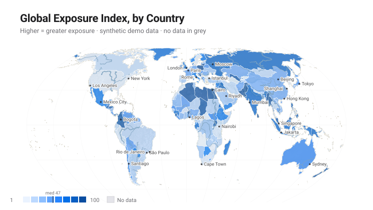
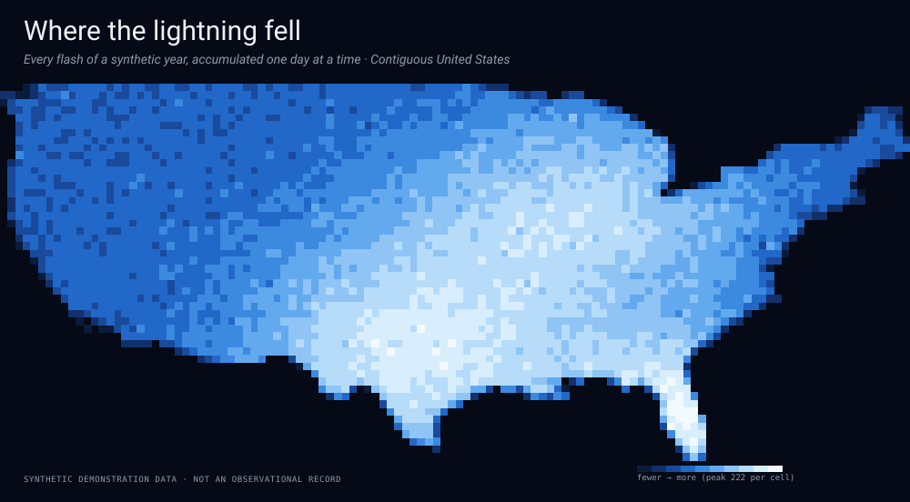

# Examples

Practical, runnable recipes for `sprezzature-maps`. See [`README.md`](README.md)
for install instructions.

This file grows alongside the project's surfaces (the Python library, the
command-line tools, the HTTP API, the Model Context Protocol or MCP
integration that lets an AI assistant call these tools directly, the
browser GUI). It is not written once and left as-is: expect new sections
as those surfaces land. The three example images below are not hand-picked
screenshots; they are the actual output of `make_choropleth()`,
`make_situation_map()` and `make_density()` called with no arguments, and
they cannot silently drift from what the code produces — not because
anyone promises to keep them fresh, but because
`tests/test_demo_examples_are_current.py` re-renders each one and fails if
the file on disk differs. Regenerate with
`python scripts/build_demo_examples.py`.

## The three demo plates

### `choropleth`



### `situation_map`


### `density`



## Python library

```python
from sprezzature_maps import make_choropleth, make_situation_map

# Demo data if none supplied.
make_choropleth(out="world.svg")
print("wrote world.svg")
# wrote world.svg

# Your own per-country data. "id" is the country's ISO-3166-1 numeric
# code (a 3-digit code every country has under the ISO 3166 standard,
# e.g. "840" for the United States, "124" for Canada).
make_choropleth(
    data=[{"id": "840", "value": 12.5}, {"id": "124", "value": -3.2}],
    title="Something, by country",
    out="custom.svg",
)

# A diverging colour scale (two colours pulling away from a neutral
# middle, for values that can be negative or positive) is picked
# automatically when the data spans both signs, as in the example above.
# Force it explicitly with diverging=True/False to override that.
make_choropleth(data=[...], diverging=True, out="growth.svg")

# The bundled Europe demo config.
make_situation_map(out="region.svg")

# Your own region: a YAML config file (YAML is a human-readable text
# format for structured data, easier to hand-edit than JSON) loaded and
# passed in as a Python dict. See scripts/make_situation_map.py's module
# docstring for the full list of fields it accepts.
import yaml
config = yaml.safe_load(open("my-region.yaml"))
make_situation_map(config=config, out="region.svg")
```

```python
from sprezzature_maps import make_density

# Synthetic demo points over the contiguous United States.
make_density(out="where.svg")

# Your own events: a list of (lon, lat) pairs, and the window they fall in.
make_density(
    points=[(2.35, 48.86), (2.29, 48.85), ...],
    bbox=(-5.0, 42.0, 9.0, 51.5),
    region="France",          # named, so the plate says what it maps
    title="Where the strikes fell",
    out="france.svg",
)
```

## Command line (`make-map`)

Built with Click, a Python library for command-line tools with
subcommands. Always installed, no extra to add. `make-map` and
`sprezzature-maps` are two spellings of the same group — they resolve to
the same callable, so they cannot differ; `make-map` is the older name and
is kept because it is what the skill, the README and years of notes tell
people to type.

```bash
# Demo data, default output path.
make-map choropleth --out world.svg

# Your own data (JSON file: a list of {"id": ..., "value": ...} rows).
make-map choropleth --data my-data.json --out world.svg --title "My indicator"

# A region config.
make-map situation_map --config my-region.yaml --out region.svg
```

### Reading a plate back

The fourth tool is the one that reads rather than draws, and it is missing
from most of this file's examples because it is the last step rather than the
first:

```bash
make-map audit world.svg                 # exit 1 on any finding
make-map audit plates/ --format json     # a whole folder, machine-readable
```

Six static rules over a rendered SVG. The two that catch the most:

- **the classification method has to be named.** The same numbers under
  quantiles and under natural breaks put different countries in the dark
  band, so a legend that shows swatches without saying how they were cut is
  a lookup table with no key;
- **the plate has to say when it was true, or that it is a schematic.** A map
  with neither is read as current forever, including years after it stopped
  being so.

It runs over any SVG, not only ones this package drew — which is how the
positioning map in [`LANDSCAPE.md`](LANDSCAPE.md) came to be dated: the rule
fired on it, and the honest fix was to stamp the figure rather than exempt
the file.

A plate that passes is not thereby a good map. It is one a reader can argue
with.

## HTTP API (`sprezzature-maps[api]`)

```bash
pip install 'sprezzature-maps[api]'
# uvicorn is the server that actually runs the API code and listens for
# requests; --reload restarts it automatically whenever a source file
# changes, handy while developing.
uvicorn sprezzature_maps.api:app --reload
```

```bash
# Demo choropleth as SVG.
curl -X POST http://localhost:8000/v1/choropleth -o choropleth.svg

# Your own data, as PNG.
curl -X POST http://localhost:8000/v1/choropleth \
  -H "Content-Type: application/json" \
  -d '{"data": [{"id": "840", "value": 12.5}, {"id": "124", "value": -3.2}], "format": "png"}' \
  -o choropleth.png

# Demo situation map.
curl -X POST http://localhost:8000/v1/situation-map -o situation_map.svg

# Demo density map.
curl -X POST http://localhost:8000/v1/density -o density.svg

# Discover the kinds programmatically instead of hardcoding them.
curl http://localhost:8000/v1/kinds
# ["choropleth", "density", "situation_map"]

# Interactive docs: a page generated automatically from the API's
# OpenAPI schema, letting you try each endpoint from the browser
# (this particular UI for it is called Swagger UI). And the GUI gallery.
open http://localhost:8000/docs
open http://localhost:8000/
```

## The same command, under its suite name (`sprezzature-maps`)

Everything above works under this name too, and everything here works
under `make-map`: one Click group, two spellings. Until 2026-10-25 these
really were two commands — an argparse `make-map` that read only a
pre-shaped JSON array, and a richer Click twin behind a `[cli]` extra —
and that is what the examples below are showing off: reading CSV/TSV/JSONL
directly (comma-separated, tab-separated, or one-JSON-object-per-line) and
`--map role=column` bindings for a file whose columns aren't already named
`id`/`value`. Those live on the sub-commands, so both names reach them.

```bash
sprezzature-maps list
# choropleth
# situation_map

# A CSV with your own column names, bound explicitly.
sprezzature-maps choropleth \
  --data my-data.csv --map id=CountryCode --map value=Score \
  --out world.svg --title "My indicator"

# Force the diverging ramp off even though the data has both signs.
sprezzature-maps choropleth --data my-data.csv --no-diverging --out world.svg

# Read the CSV from standard input (stdin: whatever another command
# pipes in, here via "|") instead of from a named file, using "-" in
# place of a path.
cat my-data.csv | sprezzature-maps choropleth --data - --out world.svg

sprezzature-maps situation-map --config my-region.yaml --out region.svg
```

## MCP (`sprezzature-maps[api,mcp]`)

MCP, the Model Context Protocol, is the standard that lets an AI
assistant call a tool directly instead of a human typing a command. This
extra exposes the same HTTP routes as MCP tools (`list_kinds`,
`render_choropleth`, `render_situation_map`) for any MCP-aware assistant
to call.

```bash
pip install 'sprezzature-maps[api,mcp]'
sprezzature-maps-mcp
# MCP endpoint at http://localhost:8000/mcp,
# alongside the regular HTTP routes and the GUI at http://localhost:8000/
```

Point an MCP client's server configuration at that URL. The tool
descriptions it advertises come straight from the FastAPI (the Python
web framework this API is built with) route docstrings in
`sprezzature_maps/api.py`, so they stay in sync with the HTTP API
automatically, with nothing to update by hand in two places.

## Conflict event data: ACLED and UCDP GED

A plate from the file a conflict researcher already has, rather than from a
config written by hand. Both loaders return a *config fragment* — keys the
generator already reads — so a hand-written config keeps everything it says
and gains the events:

```python
from sprezzature_maps import acled_events, make_situation_map

cfg = {
    "title": "Sudan: recorded political violence, 2024",
    "subtitle": "ACLED events, drawn at the precision ACLED records",
    "basemap": {"relief": True},
}
cfg.update(acled_events("sudan-2024.csv", derive_region=True))
make_situation_map(config=cfg, out="sudan.svg")
```

`sudan-2024.csv` is the export as downloaded. The loader also takes the API
body (`{"status": 200, "data": [...]}`), a `.jsonl`, or rows already in
memory — including `DataFrame.to_dict("records")`, which is how it accepts
pandas without depending on it.

### What it carries across, and why that is the point

Both datasets record **how well each row's position and date are known**, and
every other tool draws all of them as the same dot. Here the code reaches the
mark:

| Code | ACLED `geo_precision` | Drawn as |
|---|---|---|
| 1 | a named location | a solid cased disc |
| 2 | a place standing in for a general area | a hollow ring |
| 3 | a place standing in for a whole region | a hollow **broken** ring |

UCDP's `where_prec` runs 1–7 and is mapped onto those three in a table
written out in `scripts/_conflict.py`. Two cases are worth knowing before you
use it:

* `where_prec` **2** states a radius of about 25 km. It is drawn, as a
  dashed halo to the plate's own scale, rather than flattened into a code.
* `where_prec` **6** means only the country is known. The row still carries
  coordinates — every GED row does — and they are a representative point for
  the whole state. Those rows are **not drawn** by default, and the count
  goes onto the plate's method line. `country_level="keep"` overrides it.

```python
from sprezzature_maps import ucdp_events

cfg.update(ucdp_events("ged251.csv", size_by="best", derive_region=True))
# method: "1,284 UCDP events drawn; 2023-01-02 to 2023-12-30.
#          Not drawn: 37 located only to the country."
```

### Options worth knowing

| Argument | Effect |
|---|---|
| `colour_by` | ACLED only: `"event_type"` (default, six classes), `"disorder_type"` (three), `"sub_event_type"` |
| `size_by` | `"fatalities"` (ACLED) or `"best"` (UCDP). Area-true: four times the deaths is twice the radius. Off by default — a dot map of *where* and a bubble map of *how many* are different claims |
| `derive_region` | Take `region.bbox` from the events instead of writing one |
| `tooltip_from` | Name each mark in its hover tooltip from a column (`"location"`, `"admin1"`). It is **not** drawn on the plate: two hundred events is not two hundred names, and the few places worth naming are worth naming by hand in `labels.places` |
| `limit` | Keep at most *n*; the remainder is counted on the plate, never dropped in silence |
| `aggregate` | One mark per administrative unit instead of one per event: `"admin1"`, `"admin2"`, or any column name. See below |
| `vocabulary` | The classes to expect, in legend order. Fixed by default so one colour means one thing across every figure in a paper |

An unreadable precision code, an unparseable coordinate or a class outside
the vocabulary is an error naming its row, not a row skipped quietly: a
dataset that has changed under you is worth stopping for, and treating an
unreadable code as "exact" would upgrade an approximate mark into a confident
one on a plate that still looks finished.

## Printing a plate in a journal

Journals specify physical widths, not pixels: Nature 90 mm for a single
column and 180 for a double, Elsevier 90 / 140 / 190, Science 57 / 121 / 184.
They also specify a floor for the type *inside* the figure — 5 to 7 pt at
Nature and Science, 6 pt as Elsevier's minimum — and all three say to build
the figure at the width it will print at rather than scale it afterwards.

```python
cfg["print_width"] = "90mm"
```

The root then carries `width="90mm"` and the matching height, so the file
lands at exactly that size in InDesign or `\includegraphics`. Nothing about
the drawing changes: the viewBox and every path are identical, byte for byte.

What the key is really for is the second half:

```text
RuntimeWarning: at 90 mm this plate's smallest label is 1.6 pt (below every
major publisher's floor; Nature and Science ask 5 to 7 pt, Elsevier 6). The
label is 10.8 units on a 1768-unit canvas; designing the same plate at
canvas_width around 551 would print it at 5 pt.
```

That is the bundled Ukraine plate. It is designed for a screen, and at a
journal column its labels set at a third of the smallest type any publisher
accepts — which no rendering shows you, because a vector file scales silently.
A warning rather than a refusal: a poster is not a journal page.

`mm`, `cm`, `in` and `pt` are understood. A bare number with no unit is
refused, because `"90"` could be millimetres or pixels and the two differ by a
factor of three.

### Getting it out as vector

`--out plate.pdf` and `--out plate.eps` write a **drawn** page, not a picture
of one, and the page is exactly the size `print_width` asked for:

```bash
make-map situation_map --config region.yaml --out figure-1.pdf
```

That needs `rsvg-convert`, which ships with librsvg (`brew install librsvg`,
`apt install librsvg2-bin`). It is an optional system package, not a Python
dependency, and when it is missing the page is still written, still at the
right physical size, with a warning saying it is a raster and what to install.
Silence there would be the defect: a raster PDF satisfies the extension and
nothing a journal wants, and nobody can tell the two apart until they zoom in,
by which point the figure is in review.

Three converters were measured against this project's own plates before one
was picked, because the failures are not the kind you notice in a thumbnail:

| | page at `90mm` | what came back |
|---|---|---|
| `rsvg-convert` | **90.0 mm** | correct |
| `cairosvg` | 90.0 mm | **every place name erased** — it ignores `paint-order`, so each label's white halo paints over the letters instead of under them |
| headless Chromium | 90.3 mm | **printed the interactive layer panel into the figure**, and fell back to Times for part of the type |

`cairosvg` runs on the same cairo build librsvg does, so that is its SVG
parser, not the renderer underneath.

That table is a measurement, not a reputation, and it is kept true by a test
rather than by this paragraph. `tests/test_a_plate_leaves_in_the_format_it_was_asked_for.py`
exports a canary drawn exactly the way a place name is drawn, rasterises what
comes back, and compares the ink against the renderer this package ships. A
converter that erases labels scores zero, not ninety-five percent. The test
carries its own negative control — the same canary with `paint-order` removed,
which comes out blank — so it proves it can fail before it claims to pass.

Two things to know about the page you get. Text comes out as outlines rather
than as selectable text, which is what most journals ask for anyway. And the
file is not byte-reproducible — the converter stamps a creation date, which
the plate itself deliberately does not (see `provenance` above) — so two
exports of one plate differ even though the drawing does not.

## Who can read the plate

A thematic plate is a navigable document, not a picture. Its claim polygons,
its event marks and its legend controls are keyboard-reachable, and each one
names itself:

| Focus lands on | It announces |
|---|---|
| a control zone | `Russian-occupied (approx.), 15% of the mapped area` |
| a lower-confidence zone | `SPLM-N (al-Hilu), 4% of the mapped area, claimed, unverified` |
| an exact mark | `Avdiivka, named location, 2024-02-17` |
| an approximate mark | `El Fasher, approximate — a place standing in for a whole region, month of 2024-06` |
| a legend class | `Show only Ukrainian government control` |

The precision wording is the marker symbology's own. A sighted reader sees a
solid disc or a broken ring; without it in the label, a screen-reader user
would be handed the confident reading of every approximate mark on the plate —
the exact failure the symbology exists to prevent, reintroduced for the
readers least able to catch it.

The root is `role="graphics-document"` when there is something to reach and
`role="img"` when the plate really is only a basemap. That distinction is not
cosmetic: `img` makes every descendant presentational, so a perfectly named
polygon inside one is still a polygon the screen reader has been told to skip.

### Aggregating rather than pinpointing

Sometimes the honest map is the coarser one. [OCHA's data-responsibility
guidance](https://data.humdata.org/dataset/2048a947-5714-4220-905b-e662cbcd14c8/resource/8bc5b848-8ece-4f1f-a78b-18dd972bb21a/download/data-responsibility-guidelines-2025.pdf)
is blunt that a map plotting where vulnerable people are can be the thing that
finds them, and that coordinates resist anonymisation precisely because they
identify. A dot map of four thousand events over a displacement crisis is a
dot map of four thousand places somebody could go to.

```python
cfg.update(acled_events("sudan-2024.csv", aggregate="admin1", size_by="fatalities"))
```

Aggregating is the usual remedy, and it is usually done dishonestly: the pile
is drawn as a confident dot at a centroid, as though it happened there. Here
it cannot be. **An aggregate comes out at precision 3** — *a place standing in
for a whole region*, the generator's existing wording for exactly this — so it
draws as a hollow broken ring, says so in its tooltip and in its accessible
name, and the legend key draws the same broken ring rather than teaching a
solid disc beside marks that are not solid.

The plate says what happened:

```text
6 events aggregated to 3 admin1 units; each mark is a representative point
for its unit, not a location. 2024-01-15 to 2024-03-15.
```

Each mark is named `Khartoum: 3 events`, carries the window its members span
rather than one member's date, and — with `size_by` — is scaled by the unit's
total, collapsed before the scale is set so that the plate's largest disc is
the largest *unit* and not the largest single event.

`admin1` and `admin2` resolve to each dataset's own spelling (ACLED's
`admin1`, UCDP's `adm_1`); any other string is taken as a column name, and a
column the file does not have is refused by name.

One caveat, stated because it is real: the position is the mean of the member
coordinates, which on a crescent-shaped unit can fall outside the unit it
represents. That is part of why the mark is drawn at the weakest precision the
symbology has rather than a confident one.

## One panel per window of time

A plate is a snapshot; most of what research says about a conflict is a
change. `small_multiples` cuts the same config into one panel per `"year"`,
`"quarter"`, `"month"`, `"week"` or `"day"`:

```python
cfg = {"title": "Recorded political violence, by quarter"}
cfg.update(acled_events("export.csv", derive_region=True, size_by="fatalities"))
cfg["small_multiples"] = {"by": "quarter", "columns": 4}
make_situation_map(config=cfg, out="by-quarter.svg")
```

| Key | Effect |
|---|---|
| `by` | The window: `"day"`, `"week"`, `"month"`, `"quarter"` (default `"year"`) |
| `from`, `to` | The span to cover, as ISO dates. Defaults to the span of the dated marks; widen it to state the period under study rather than let the data define it |
| `columns` | Panels per row (default: up to four) |
| `panel_width` | One panel's width in plate units (default 420) |

Everything but the marks comes from the single config, so the extent, the
projection, the basemap and the symbol scale cannot drift between panels the
way they do when you export one plate per window — and the sheet draws the
title, the key, the ruler and the credits once rather than once per panel.
The split happens **after** the loader has run: `acled_events` sizes a
proportional disc from the largest value in the file, so calling it once per
window would give each window its own largest value and the same disc would
stand for a different number in every panel.

Two rules it will not bend.

**A window with nothing in it is still a panel.** A quiet quarter is
evidence. Dropping its panel closes the gap, and the panels on either side
then read as consecutive.

**A mark is placed only where its own `time_precision` allows.** A row dated
*month of March* is an interval, not a day: it belongs in a March panel and
in no week panel, and a week beginning 28 March reaches into April so it
belongs in neither month. What fits in no single window is not drawn and is
counted on the sheet — *Not placed: 8 dated only to a year, which no single
quarter panel contains* — the same answer the loaders give to a coordinate
known only to the country.

Past sixty panels the call is refused rather than drawn: pick a coarser `by`
or narrow the span.

## Drawing the borders of a past year

The vendored basemap is present-day. For most plates that is what
"international frontiers" means; for a plate of 1995 it is exactly wrong. A
map of the Bosnian war with today's borders on it shows a Bosnia that did not
exist in the form it draws, and nothing on the page says so.

```python
cfg["frontiers"] = {
    "source": "cshapes_2.0.geojson",
    "as_of": "1995-06-30",
}
```

The same plate at `1990-06-30` names **Yugoslavia**; at `1995-06-30` it names
**Croatia** and **Serbia** and draws the border between them. The frontier
lines, the neighbour labels and the de-duplicated inner lines all come from
the historical source; the rest of the layer does not know which source it was
handed.

**A bare year is refused.** `as_of: 1991` is ambiguous for exactly the borders
this exists to draw — the Soviet Union existed on 1991-01-01 and did not on
1991-12-31 — so the error asks for a full date and shows one.

**Nothing is vendored, and that is a licence, not an oversight.**
[CShapes 2.0](https://doi.org/10.1177/00220027211013563) is the only GIS
dataset mapping state borders worldwide from 1886, and it is published under
CC BY-NC-SA 4.0. Bundling it into this BSD-licensed package would attach a
non-commercial clause to the package and a share-alike obligation to anything
built on it. It is free for the academic use this feature is for, so you
download it and the licence stays with you. `fields` renames the properties
for any other source:

```python
cfg["frontiers"]["fields"] = {"name": ("label",), "start": ("from_y", "m", "d")}
```

Two caveats, stated rather than hidden. The coastline is present-day, which is
right — coastlines have not moved. The **cities are present-day too**: a 1990
plate will still name the towns the vendored basemap knows, so a plate of a
renamed or vanished place needs `labels.places` written by hand.

## Saying which inputs drew a plate

`method`, `source` and `as_of` are prose: what the plate was drawn from,
written for a reader. They cannot settle the question review asks of a
published figure — *is this the picture these inputs produce?* The drawing is
a function of three things, so `provenance` fingerprints all three into
`<metadata>`, which occupies no pixels:

```python
cfg = {"title": "Sudan: recorded political violence, 2024", "provenance": True}
cfg.update(acled_events("sudan-2024.csv", derive_region=True))
make_situation_map(config=cfg, out="sudan.svg")
```

```xml
<metadata id="provenance" data-generator="sprezzature-maps"
          data-version="0.17.0" data-config-sha256="9a1f…">
  <provenance-input data-name="sudan-2024.csv" data-sha256="3f2a…" data-bytes="4812051"/>
</metadata>
```

The export is in there without the config naming it. By the time
`make_situation_map` sees that config the rows are inline and the file is
gone; the loader is the only point in the chain that still knows which CSV it
read, so it records one and the stamp picks it up. Anything else that fed the
plate — a frontiers file, an elevation raster you supplied — goes in by hand:

```yaml
provenance:
  inputs: [cshapes-2.0.geojson]     # relative to the config's own directory
```

Reading it back is the other half:

```python
from sprezzature_maps import plate_provenance, replay_report

plate_provenance(svg)
# {"generator": "sprezzature-maps", "version": "0.17.0",
#  "config_sha256": "9a1f…", "inputs": [{"name": "sudan-2024.csv", ...}]}

report = replay_report(svg, cfg, ["sudan-2024.csv"])
report["replays"]        # True only when everything the stamp named matched
report["differences"]    # one sentence per thing that moved, empty otherwise
report["unchecked"]      # stamped inputs nobody supplied
```

`replays` is `True` only when everything the stamp names was checked **and**
matched. An input nobody handed over lands in `unchecked` and makes it
`False`: nothing in the plate can go looking for the file — it kept a basename
and a digest, never a directory — so a caller who supplied nothing has checked
nothing, and a plate whose inputs nobody produced is unrefuted rather than
reproduced. A plate with no stamp at all raises, instead of reporting a match
for a figure that recorded nothing.

`choropleth` and `density` take keyword arguments rather than a config dict,
and `provenance=True` digests the whole call, defaults included. There is no
dict to hand `replay_report` for one of those, so the check is the other way
round: render again with the arguments you believe were used and compare the
two `config_sha256` values.

### Three choices, each the opposite of the easy one

**Digests, not the inputs.** An `areas_of_control` config carries coordinates;
a `source` carries a path that names somebody's machine. Embedding either
would make the file self-describing and would also publish it. A digest
publishes nothing and still lets anyone holding the inputs prove the match,
which is the direction a reviewer needs it to work in. Only basenames are
kept, for the same reason.

**No clock.** A render time is the obvious field and it would destroy the
property the stamp exists to record: two renders of the same inputs would
differ, and the reviewer comparing them would be told they do not match.

**Off by default.** Not because it costs pixels — it is byte-identical once
rasterised — but because it carries the package version, so switching it on
for everyone would change every committed plate at every release. The conflict
loaders do not switch it on either; they only leave the record for a config
that asked.

On a sheet of small multiples the stamp is written once, on the sheet. Eight
panels inheriting it would list one ACLED export eight times, and a reader
counting inputs would count eight.
